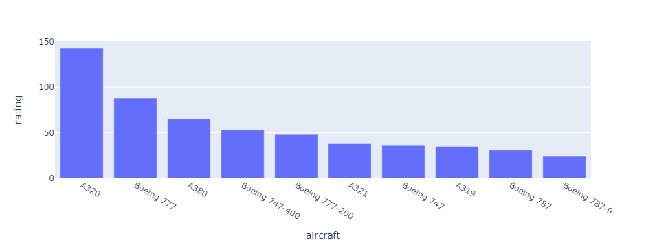
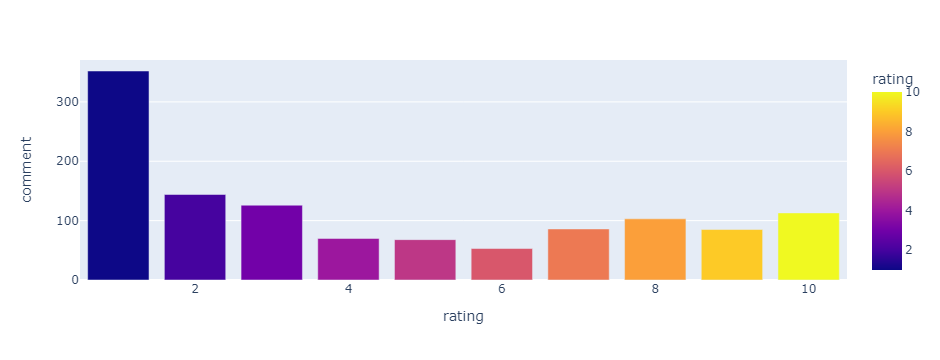
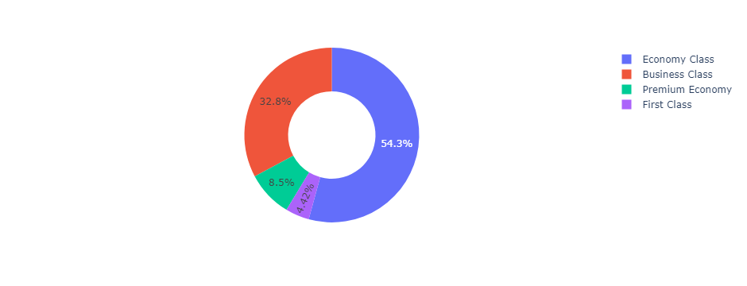
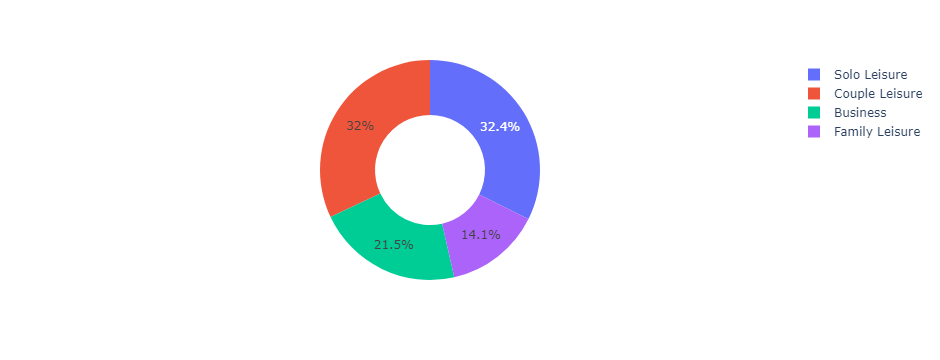
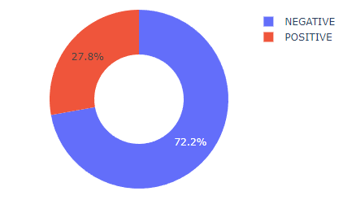
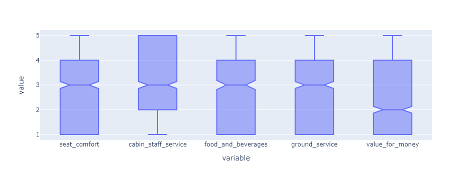

# Review insights: my one-slide summary

This is the text and the charts from the single slide I wrote for the first module, lightly copy-edited. The original deck used the programme's PowerPoint template, so it is not included.

> Most of our passengers fly on the A320, Boeing 777, A380, Boeing 747 and A321. Most reviewers are solo leisure travellers and choose to fly Economy.
>
> However, most reviewers left a low rating. Based on the sentiment model, 72.2% left negative reviews and only 27.8% had positive impressions.

## Charts

Number of reviews by aircraft, top ten:

Number of reviews by overall rating, from 1 to 10:

Share of reviews by seat type:

Share of reviews by traveller type:

Share of reviews labelled negative and positive by the sentiment model:

Spread of the five category scores (seat comfort, cabin staff service, food and beverages, ground service and value for money):

