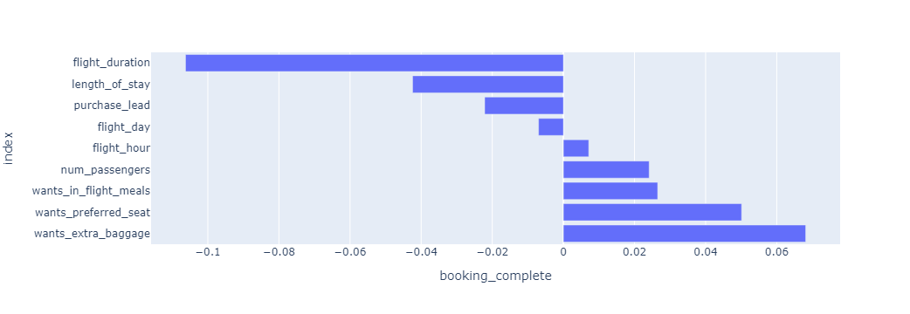

# Booking prediction: my one-slide summary

This is the text and the chart from the single slide I wrote for the second module, lightly copy-edited. The original deck used the programme's PowerPoint template, so it is not included.

> According to the data exploration, no attribute has a strong relationship with the final purchase behaviour.
>
> After processing the categorical variables and building a neural network classifier, we obtained a final model with a train score of 0.85025 and a test score of 0.85190.
>
> There is still room to improve the prediction model. We suggest adding more external data to give a better prediction for further business use.

## Chart

Correlation of each feature with a completed booking:

